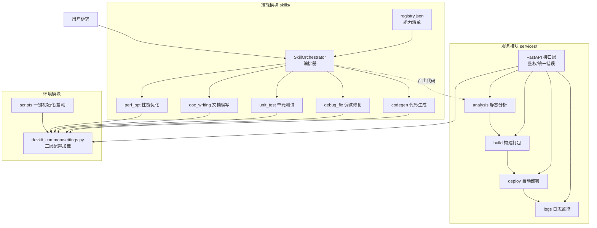
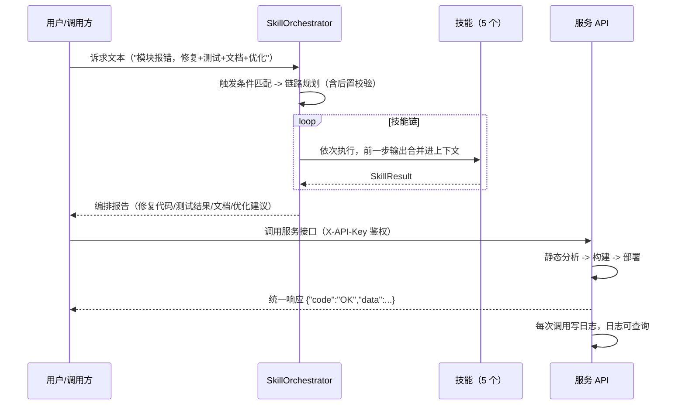

# 01 · 架构总览

## 1. 定位

本套件为"开发代码助手自身"提供三件事：

1. **能力**（技能模块）：助手完成任务所需的最小能力单元，声明式定义、可编排。
2. **环境**（环境模块）：让这套代码在任何机器上可复现地跑起来。
3. **服务**（服务模块）：把能力变成可被外部/远端调用的 HTTP 接口。

三者关系：技能模块与服务模块共享 `devkit_common` 配置层；编排器驱动技能模块产出代码，
服务模块对产出做分析、构建、部署与监控。

## 2. 总体架构

## 3. 核心数据流（一次完整任务）

## 4. 分层与目录职责

| 层 | 目录 | 职责 | 依赖 |
| --- | --- | --- | --- |
| 公共层 | `devkit_common/` | 配置加载（默认值/YAML/.env/环境变量） | 纯标准库 |
| 技能层 | `skills/` | 能力定义、注册、编排 | 纯标准库（可脱离服务独立运行） |
| 核心层 | `services/core/` | 分析/构建/部署/日志业务逻辑 | 纯标准库 + 配置 |
| 接口层 | `services/api/` | HTTP 路由、鉴权、统一错误、模型 | FastAPI |
| 示例层 | `examples/` | 调用示例、端到端演示、演示项目 | httpx |
| 测试层 | `tests/` | 单元 + 集成 + 端到端 | pytest |

## 5. 关键设计决策

- **技能零依赖**：技能模块不 import 任何第三方库，保证在受限环境（如纯计算沙箱）也能跑。
- **服务与技能解耦**：技能产出的是"代码/文档/建议"；服务消费的是"文件/项目"。二者通过文件系统衔接，互不依赖。
- **统一错误契约**：所有接口错误都返回 `{code, message, details}`，客户端只需按 code 分支。
- **可替换性**：静态分析核心可换 pyflakes/mypy、构建核心可换 build 工具、部署核心可换容器推送——接口不变。
